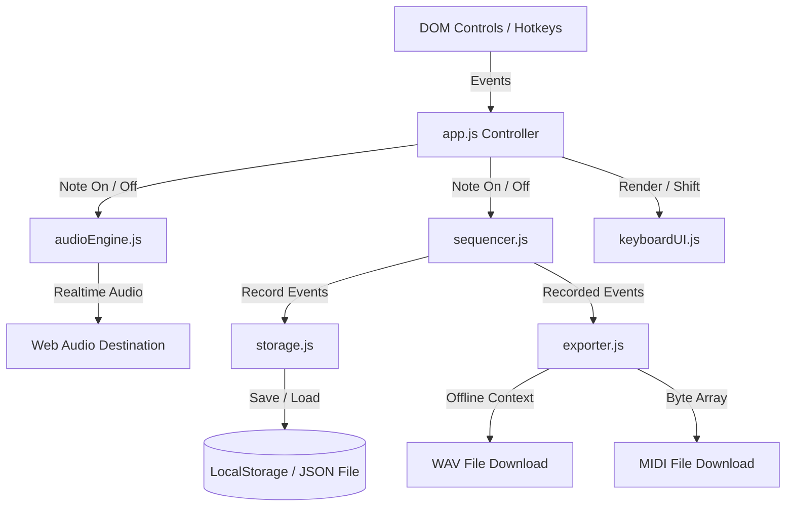

# Web Audio Synthesizer & Sequencer

A lightweight, zero-dependency browser-based virtual synthesizer and event sequencer built with modern JavaScript ES modules and the Web Audio API.

---

## Features

* **Polyphonic Synthesis Engine**: Custom Web Audio API node management with configurable waveforms (Sine, Square, Sawtooth, Triangle), volume control, and dynamic ADSR envelope timing (Attack and Release).
* **Flexible Virtual Keyboard**: Dynamic multi-octave rendering supporting 13, 25, and 37-key configurations.
* **Dual Layout Modes**:
* **DAW Block**: Sequential octaves mapped across standard keyboard rows (`Z–M`, `Q–U`, `I–;`).
* **Split Layout**: Ergonomic split-hand mapping separating lower and upper octaves between left and right hands.


* **Real-time Event Sequencer**: Record, play back, and clear note-on/note-off event queues with precision timing offsets.
* **Storage & Export Suite**:
* **LocalStorage**: Automatic sequence state persistence across browser reloads.
* **JSON Export/Import**: Save and restore sequence project files.
* **WAV Rendering**: Offline audio rendering via `OfflineAudioContext` to export uncompressed `.wav` audio files.
* **MIDI Export**: Standard `.mid` file generation for DAW integration.


---

## Architecture & Directory Structure

```
.
├── index.html          # Main HTML structure and control panel
├── style.css           # Dark theme styles and responsive piano key layout
└── js/
    ├── app.js          # Application entry point & DOM event wiring
    ├── audioEngine.js  # Web Audio API wrapper and synth voice management
    ├── keyboardUI.js   # Dynamic key rendering and hotkey mappings
    ├── sequencer.js    # Note event recording and playback logic
    ├── storage.js      # LocalStorage & JSON import/export manager
    └── exporter.js     # Offline WAV rendering and MIDI file generator

```

### Data Flow & Component Architecture



---

## Hotkey Mapping Specifications

### DAW Block Mode

| Key Range | Keyboard Mapping | Octave Offset |
| --- | --- | --- |
| **Octave 1** | White: `Z X C V B N M`<br>

<br>Black: `S D G H J` | Base Octave ($O_{base}$) |
| **Octave 2** | White: `Q W E R T Y U`<br>

<br>Black: `2 3 5 6 7` | $O_{base} + 1$ |
| **Octave 3** | White: `I O P [ ] \`<br>

<br>Black: `8 9 - =` | $O_{base} + 2$ |
| **High C** | `'` (Single Quote) | $O_{base} + 3$ |

### Split Layout Mode

| Key Count | Left Hand Mapping | Right Hand Mapping | High C |
| --- | --- | --- | --- |
| **37-Key** | Octave 1 (`Z–M` / `S–J`)<br>

<br>Octave 2 (`Q–U` / `2–7`) | Octave 3 (`I–;` / `8–=`) | `'` |
| **25-Key** | Octave 1 (`Q–U` / `2–7`) | Octave 2 (`I–;` / `8–=`) | `'` |
| **13-Key** | Octave 1 (`Q–U` / `2–7`) | — | `'` |

---

## Mathematical Foundations

Pitch frequencies are dynamically calculated using the standard 12-tone equal temperament tuning formula with $A_4 = 440\text{ Hz}$:

$$f(n) = 440 \times 2^{\frac{n - 69}{12}}$$

Where $n$ represents the MIDI note number calculated from the octave offset $O$ and pitch index $p \in \{0, 1, \dots, 11\}$:

$$n = (O + 1) \times 12 + p$$

---

## Getting Started

### Prerequisites

A web browser with native ES Module support and Web Audio API capabilities (Chrome, Firefox, Edge, Safari).

### Running the Application

Because ES Modules require HTTP/HTTPS origin, serve the root folder via any local web server:

```bash
# Using Python 3
python -m http.server 8000

# Using Node.js npx
npx serve .

```

Open `http://localhost:8000` in your browser.

---