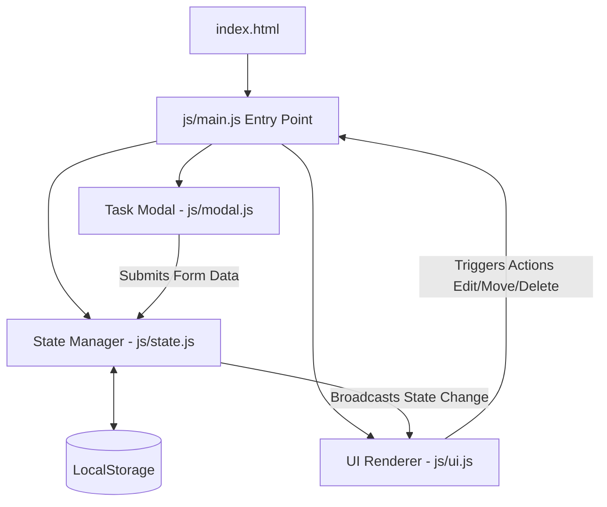

# Kanban Board

A lightweight, zero-dependency Kanban board application built using native ES6 Modules, CSS Grid/Flexbox, and modern HTML5. It provides task lifecycle management, multi-tag parsing, overdue task detection, and LocalStorage state persistence with JSON backup and restore capabilities.

## Features

* **Modular ES6 Architecture**: Pure JavaScript separated into single-responsibility modules (`State`, `UI`, `TaskModal`).
* **Task Lifecycle Management (CRUD)**: Create, edit, move between lanes, and delete task cards.
* **Multi-Tag Support**: Parses comma-separated inputs into individual tag badges rendered on each card.
* **Priority Visual Badging**: Color-coded indicators for `low`, `medium`, and `high` priority levels.
* **Overdue Task Highlighting**: Automatically detects when a task's due date has passed (for non-completed items) and highlights it with a warning status.
* **State Persistence**: Automatic synchronization with `localStorage` to preserve state across browser sessions.
* **Data Import & Export**: Export full board configurations to `.json` files and import them on demand.
* **Responsive Dark Theme**: Modern dark-mode layout built with CSS Grid, Flexbox, and custom scrollbar styling.

---

## File Architecture

```
kanban-board/
├── index.html          # Application layout, header actions, and task modal form
├── css/
│   └── styles.css      # Design tokens, layout grid, tag badges, and overdue states
└── js/
    ├── main.js         # Entry point, event binding, and application orchestrator
    ├── state.js        # State store, LocalStorage sync, and JSON import/export
    ├── modal.js        # Modal view controller and tag parser
    └── ui.js           # Dynamic DOM renderer and card generator

```

---

## System Architecture & Data Flow



---

## Data Schema

### Task Entity

| Attribute | Type | Description |
| --- | --- | --- |
| `id` | `string` | `null` | Unique identifier (timestamp-based or auto-generated) |
| `title` | `string` | Task title (*required*) |
| `description` | `string` | Details or context for the task |
| `priority` | `string` | Priority ranking: `low` | `medium` | `high` |
| `tags` | `Array<string>` | Parsed list of tag strings |
| `status` | `string` | Current lane: `todo` | `in-progress` | `done` |
| `dueDate` | `string` | ISO Date string (`YYYY-MM-DD`) |

---

## Getting Started

1. **Clone or Download** the project repository files.
2. **Serve the Application** using a local web server (required for native ES Module imports):
* **Node.js**: `npx serve .`
* **Python 3**: `python -m http.server 8000`
* **VS Code**: Use the *Live Server* extension.


3. Open `http://localhost:8000` in any modern web browser.

---

## Operations Guide

* **Create Task**: Click `+ Add Task`, fill in the title, details, select a priority, and input tags separated by commas (e.g., `Feature, UI, Critical`).
* **Edit Task**: Click `✏️ Edit` on a task card to open the modal populated with existing task data.
* **Move Status**: Click `➔ Move` on a card to shift it across status lanes (`To Do` $\rightarrow$ `In Progress` $\rightarrow$ `Done`).
* **Delete Task**: Click `🗑️` to remove the card from state.
* **Export Board**: Click `Export JSON` to download the active state file.
* **Import Board**: Click `Import JSON` to restore or replace board state from a valid `.json` backup.

---